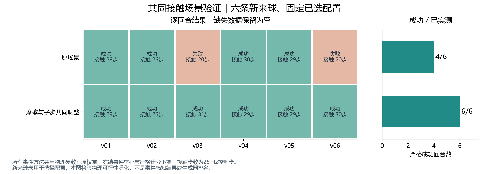

# 公共抓持场景校准与事件闭环检查

本轮先解决共同任务本身不够稳的问题，再检验事件来源差异。所有实测均在 g3 的 Genesis 1.2.2 上完成，原 Catch It! 权重、7°机位和冻结事件生成核心保持不变。

## 已完成：共同物理场景

| 公共配置 | 六条校准来球 | 六条新来球验证 |
|---|---:|---:|
| 原配置 | 3/6 | 4/6 |
| 仅手部摩擦 ×1.5 | 5/6 | 未安排 |
| 每个物理步分成两个子步 | 3/6 | 未安排 |
| 两者结合 | **6/6** | **6/6** |

以上控制输入为原项目带噪真实状态参考，**不是事件控制成功率**。公共参数只根据这组参考选择，没有根据 Ours/V2E 的输赢选择。新验证来球在校准结束前固定，验证期间没有继续调参。

校准只改变手掌及手指的17个碰撞体摩擦（1.0→1.5），以及物理子步（1→2）。球、地面和车轮摩擦保持不变，外层物理步仍为2 ms，控制仍为25 Hz。子步变化也使后端实际接触时间常数下限从4 ms变为2 ms；实际值已逐碰撞体读回归档。

成功定义保持一致：原任务到达结束时间、没有失败终止、发生真实手球接触，且最后一个控制步仍有真实手球接触。`success=True` 但同时 `terminated=True` 的回合仍按失败计；没有放宽原评分或粘连球体。

[同一来球修改前后视频](media/contact_calibration_h01_side_by_side.mp4) / [循环GIF](media/contact_calibration_h01_side_by_side.gif)。录像来自两条实际Genesis控制轨迹的渲染重放，不推进新物理；图中明确标注GT参考，不代表事件方法比较。失败回合终止后保持末帧，并显示提示。

## 事件对照

已启动固定公共配置下的18个回合：六条新来球分别运行 Ours、V2E 和“首帧RGB-D后停止所有事件更新”的消融。全部使用25 Hz稀疏端点、同一估计器和原策略权重。完整结果完成后另行归档；本文件此版本不报告尚未完成的成功率。

此前的八条强光开发回合已经完成且全部保留：强度400下 Ours/V2E各1/2，强度1600下分别1/2、2/2；**尚未显示 Ours 优势**。强度是渲染器单位，V2E对照限定为实际运行的SSM39+LDR视频路径，不代表其所有模式。

32条旧事件缓存也完成了关联策略复核：原算法均能精确复现；当前候选只改变 Ours 的一条启动失败。更保守的fallback方案和当前候选汇总结果一致，没有依据为此再改估计器。

## 复现与证据

- 运行代码提交：`2f063b7`；封存源目录：`source_contact_1a013dfe46f1`。
- 公共校准：`contact_calibration/CONTACT_CALIBRATION_RESULTS.json`、逐条CSV和审计。
- 新来球验证：`contact_validation/CONTACT_VALIDATION_RESULTS.json`、逐条CSV和审计。
- 全部原始轨迹、输入、运行日志及哈希在服务器共享目录：`/home/zhaoyuhan/Eventbased_WAM/runs/robot_scenes/mature_catch/hdr_utility_diagnosis_20261108a/`。
- 原策略SHA256：`81585772adf9b368e299875a3dce29247e23c641d8294295bec07dfb6450aaf6`。
- 冻结事件配置SHA256：`dbcf85fe3c86ae21972d4f5b79638018ca44f46a39b8cb1e14e8b6cff3a31a8a`。
- 逐文件源、核心和检查点哈希见 `evidence/CONTACT_RUNTIME.json` 及各协议、审计清单。接触校准SHA清单为演示渲染前的运行快照；演示媒体另有独立来源和变换哈希。

这些结果支持选择更稳定的共同任务场景；事件生成器效用仍以配对闭环实验为准。
