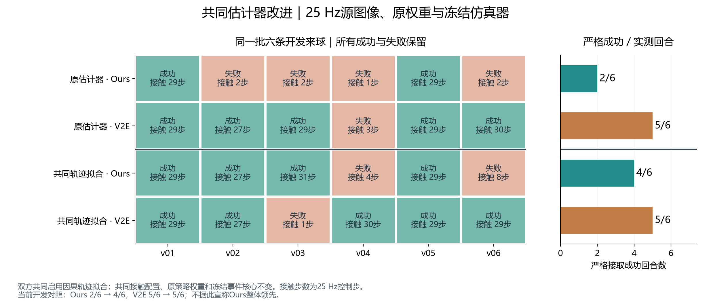
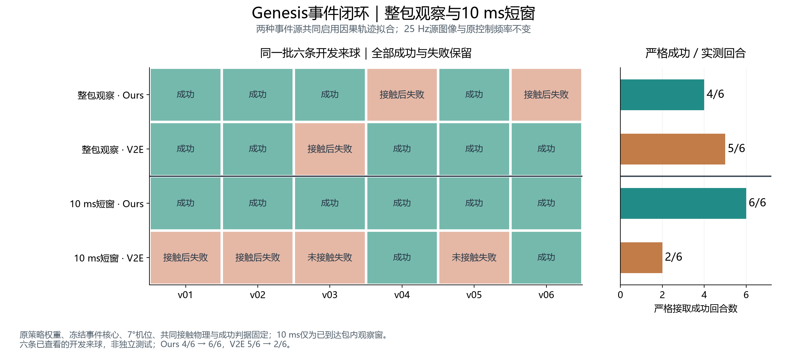

# 公共抓持场景校准与事件闭环检查

<!-- CURRENT_OVERVIEW -->
最新实际完成：共同10ms前端下，Ours 6/6、V2E 2/6；同六条开发来球全部保留。旧整包前端V2E领先的结果也完整列出。固定配置后的41–46新种子、24回合确认尚无完整评分。
<!-- END_CURRENT_OVERVIEW -->

本轮先解决共同任务本身不够稳的问题，再检验事件来源差异。所有实测均在 g3 的 Genesis 1.2.2 上完成，原 Catch It! 权重、7°机位和冻结事件生成核心保持不变。

## 已完成：共同物理场景

| 公共配置 | 六条校准来球 | 六条新来球验证 |
|---|---:|---:|
| 原配置 | 3/6 | 4/6 |
| 仅手部摩擦 ×1.5 | 5/6 | 未安排 |
| 每个物理步分成两个子步 | 3/6 | 未安排 |
| 两者结合 | **6/6** | **6/6** |

以上控制输入为原项目带噪真实状态参考，**不是事件控制成功率**。公共参数只根据这组参考选择，没有根据 Ours/V2E 的输赢选择。新验证来球在校准结束前固定，验证期间没有继续调参。

校准只改变手掌及手指的17个碰撞体摩擦（1.0→1.5），以及物理子步（1→2）。球、地面和车轮摩擦保持不变，外层物理步仍为2 ms，控制仍为25 Hz。子步变化也使后端实际接触时间常数下限从4 ms变为2 ms；实际值已逐碰撞体读回归档。

成功定义保持一致：原任务到达结束时间、没有失败终止、发生真实手球接触，且最后一个控制步仍有真实手球接触。`success=True` 但同时 `terminated=True` 的回合仍按失败计；没有放宽原评分或粘连球体。

[同一来球修改前后视频](media/contact_calibration_h01_side_by_side.mp4) / [循环GIF](media/contact_calibration_h01_side_by_side.gif)。录像来自两条实际Genesis控制轨迹的渲染重放，不推进新物理；图中明确标注GT参考，不代表事件方法比较。失败回合终止后保持末帧，并显示提示。

## 事件对照

固定公共配置下的18个回合已全部完成并通过原始事件和因果包检查。六条新来球分别运行 Ours、V2E 和“首帧RGB-D后停止所有事件更新”的消融；全部使用25 Hz稀疏端点、同一估计器和原策略权重。

| 方法 | 接触到球 | 最终接取成功 |
|---|---:|---:|
| Ours | 6/6 | **2/6** |
| V2E | 6/6 | **5/6** |
| 停止后续事件更新 | 2/6 | **1/6** |

共同物理场景已更稳定，但这组结果仍没有显示 Ours 的接取优势。所有成功和失败均保留，结果没有按种子筛选。

八条实际缓存输入的同轨迹估计器对照已完成：速度误差中位数8/8下降，位置7/8下降，V2E一例位置退化1.5mm保留。随后双方共同启用因果飞行拟合，相同六条开发来球的12个实际闭环也已完成：Ours 4/6，V2E 5/6。原权重、冻结事件核心、共同物理场景不变。

此前的八条强光开发回合已经完成且全部保留：强度400下 Ours/V2E各1/2，强度1600下分别1/2、2/2；**尚未显示 Ours 优势**。强度是渲染器单位，V2E对照限定为实际运行的SSM39+LDR视频路径，不代表其所有模式。

32条旧事件缓存也完成了关联策略复核：原算法均能精确复现；当前候选只改变 Ours 的一条启动失败。更保守的fallback方案和当前候选汇总结果一致，没有依据为此再改估计器。

<!-- CURRENT_RESEARCH_DELIVERY -->
## 当前完成结果与事件演示

### GT参考：共同物理场景（非事件控制）

| 共同场景检查 | 原接触配置 | 共同新接触配置 |
|---|---:|---:|
| 六条GT校准来球 | 3/6 | 6/6 |
| 六条新GT来球验证 | 4/6 | 6/6 |

### 事件输入：同一批六条开发来球

| 双方共同使用的估计器配置 | Ours | V2E |
|---|---:|---:|
| 原整包前端 | 2/6 | 5/6 |
| 整包前端＋因果飞行拟合 | 4/6 | 5/6 |
| 10ms子窗＋因果飞行拟合 | 6/6 | 2/6 |

旧前端V2E领先的两组完整结果保留；新10ms结果是本批固定开发来球上的配对发现，不作为所有场景或未见条件的总体排名。

- [Ours同一来球：原估计器与共同拟合](media/event_v03_ours_shared_estimator.mp4) · [GIF](media/event_v03_ours_shared_estimator.gif)。v03由失败变成功，完整Ours为4/6。
- [代表来球：Ours与V2E共同拟合](media/event_v03_representative_ours_v2e.mp4) · [GIF](media/event_v03_representative_ours_v2e.gif)。本例Ours成功、V2E失败，完整批次不支持Ours整体领先。全部成功与失败保留。

两版事件demo均来自真实Genesis控制轨迹的实际渲染重放，不推进新物理、不修改控制，版本对应原整包/共同拟合阶段；不把这些旧录像称作10ms窗口的新演示。原始片段及来源/变换哈希在event_demo_v03与media manifest。

## 10ms事件子窗：当前独立主线

已完成实际配对：Ours 6/6，V2E 2/6。完整逐条结果见contact_paired25_windows10。

源图像仍25Hz，子窗继承原包到达时间，不提前控制，不增加RGB-D/HDR预算。原权重、冻结事件核心、共同场景与飞行拟合不变；50ms运动确认规则未改，不含measurement-bootstrap候选。

## 固定配置后的未见来球确认

未用过的41–46种子、六条新来球×Ours/V2E/停止后续更新/GT参考共24回合已在g3启动，代码85c979e，尚无完整结果。配置固定，不再按这批结果调参或选种子。

实际目录`contact_windows10_unseen25`；协议SHA256：`af63a4d8594a1eeae26c914d0da2c38519d8cc4b859d3809e94f33e565b8f1a8`。当前不填入任何未完成分数。学界先例和本轮结果索引见[primary文献与当前状态](reviews/hdr_audit/PRIMARY_LITERATURE_AND_CURRENT_STATUS.md)。

旧缓存子窗诊断、生产提取一致性、文献先例与GT数据流审查均已归档在reviews/forensics与reviews/policy_review。production_observation10_cache和bootstrap_cached8的SUMMARY.json由原服务端results/SUMMARY.json精确portable提取，内容未修改；完整大JSON和raw仍在服务器。12.5Hz原生离线一致性已通过，12.5Hz物理回合尚未运行。

Bootstrap共享初始化候选仅为独立缓存探索：早期位置6/8改善但Ours有两条退化，速度无一致收益，未切默认、未与10ms主线组合。详见reviews/hdr_audit/BOOTSTRAP_ACTUAL_REVIEW.md。

本归档仅复制小报告、指标和少量演示；raw events、HDR缓存、checkpoint等大产物只按原路径/哈希索引，不重复复制。实时CURRENT_STATE由主会话维护，本脚本不写入它。
<!-- END_CURRENT_RESEARCH_DELIVERY -->

## 复现与证据

- 运行代码提交：`2f063b7`；封存源目录：`source_contact_1a013dfe46f1`。
- 公共校准：`contact_calibration/CONTACT_CALIBRATION_RESULTS.json`、逐条CSV和审计。
- 新来球验证：`contact_validation/CONTACT_VALIDATION_RESULTS.json`、逐条CSV和审计。
- 全部原始轨迹、输入、运行日志及哈希在服务器共享目录：`/home/zhaoyuhan/Eventbased_WAM/runs/robot_scenes/mature_catch/hdr_utility_diagnosis_20261108a/`。
- 原策略SHA256：`81585772adf9b368e299875a3dce29247e23c641d8294295bec07dfb6450aaf6`。
- 冻结事件配置SHA256：`dbcf85fe3c86ae21972d4f5b79638018ca44f46a39b8cb1e14e8b6cff3a31a8a`。
- 逐文件源、核心和检查点哈希见 `evidence/CONTACT_RUNTIME.json` 及各协议、审计清单。接触校准SHA清单为演示渲染前的运行快照；演示媒体另有独立来源和变换哈希。

这些结果支持选择更稳定的共同任务场景；事件生成器效用仍以配对闭环实验为准。
