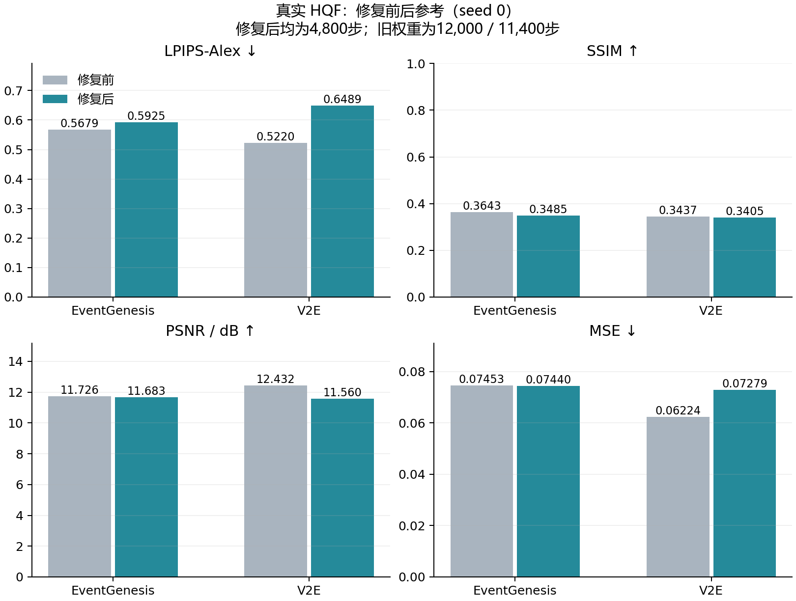

# 重建修复后的真实HQF等步数配对开发测试

完成时间：2026-11-08 01:58 JST。本轮没有训练更新；光流和位姿作业未改动。

两组均使用既存的seed0、第80轮/4,800步synthetic_best.pt，权重在接触本轮HQF结果前固定。每组全部14条序列、15,498帧，总计28次序列推理和30,996次帧评分，原事件窗口、anchor排除、循环状态、native裁剪和float32指标协议保持不变。

| 方法 | 配置/检查点步数 | LPIPS-Alex ↓ | SSIM ↑ | PSNR/dB ↑ | MSE ↓ |
|---|---|---:|---:|---:|---:|
| EventGenesis | 修复前 / 12,000 | 0.56791 | 0.36432 | 11.726 | 0.07453 |
| EventGenesis | 修复后 / 4,800 | 0.59247 | 0.34848 | 11.683 | 0.07440 |
| V2E | 修复前 / 11,400 | 0.52198 | 0.34374 | 12.432 | 0.06224 |
| V2E | 修复后 / 4,800 | 0.64894 | 0.34047 | 11.560 | 0.07279 |

**本轮结论：两个当前检查点未出现近黑或平坦输出，但两组真实HQF的LPIPS-Alex均未超过各自旧seed0结果。稳定性改善不等于真实重建质量改善。** 旧权重训练更久，现阶段不能把差距单独归因于sigmoid约束或训练不足。

## 怎样理解前后变化

- EventGenesis：LPIPS变化+0.02456（升高4.3%），SSIM变化-0.01584，PSNR变化-0.044dB，MSE变化-0.00014；LPIPS在1/14条序列改善。
- V2E：LPIPS变化+0.12696（升高24.3%），SSIM变化-0.00327，PSNR变化-0.871dB，MSE变化+0.01055；LPIPS在1/14条序列改善。

**前后表是历史参考，不是严格等预算修复消融。** 修复前权重分别为12,000和11,400步，修复后均为4,800步，训练配方的输出激活也不同；不能把全部差值归因于单个机制。当前两组修复后检查点之间预算相同，但只有一个seed，不构成多seed生成器优劣结论。

本次权重来自seed0，不直接证明seed2在真实域已恢复；seed2修复证据目前仍来自此前合成短训。HQF此前已查看，本轮明确属于既见数据开发测试，不能称盲测，也没有使用分数换权重、挑序列、修改亮度后处理或启动新训练。

指标先在各序列内按帧平均，再对14条序列等权平均。LPIPS-Alex使用原锁定PerceptualSimilarity v0.1实现与本地AlexNet权重；SSIM/PSNR/MSE计算函数及score_pair循环均未修改。没有GT亮度拟合、直方图匹配或图像输入网络。

[逐序列CSV](tables/hqf14_all_sequence_comparison.csv) · [汇总CSV](tables/hqf14_seed0_repair_comparison.csv) · [完整轻量证据](evidence/hqf_result_summary.json)

服务器保留完整float预测、原始逐帧分数、日志、协议和SHA；仓库只纳入代码、轻量证据与表格。原15组完整结果和本轮预检失败记录均未覆盖。

## 真实输出退化核对

- eventgenesis_seed0：全部15,498帧范围及有限性通过；等序列近黑比例0.00%、低对比度平坦帧比例0.00%，平均帧内标准差0.05309。
- v2e_seed0：全部15,498帧范围及有限性通过；等序列近黑比例0.00%、低对比度平坦帧比例0.00%，平均帧内标准差0.04479。

“平坦帧”阈值沿用合成诊断的帧内标准差<0.001；近黑要求同时平均亮度<0.01。只作结果诊断，没有把真实标签用于训练或选点。
