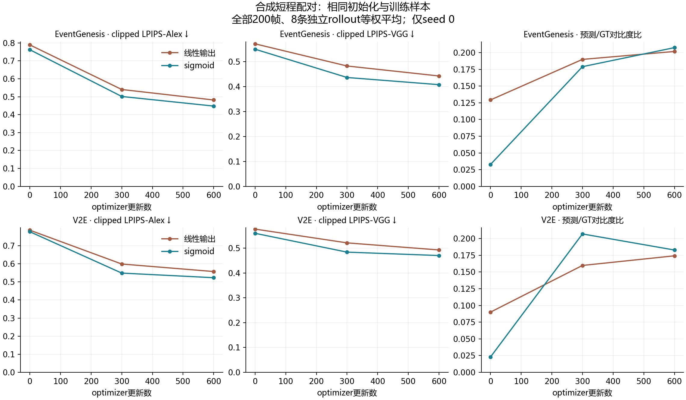
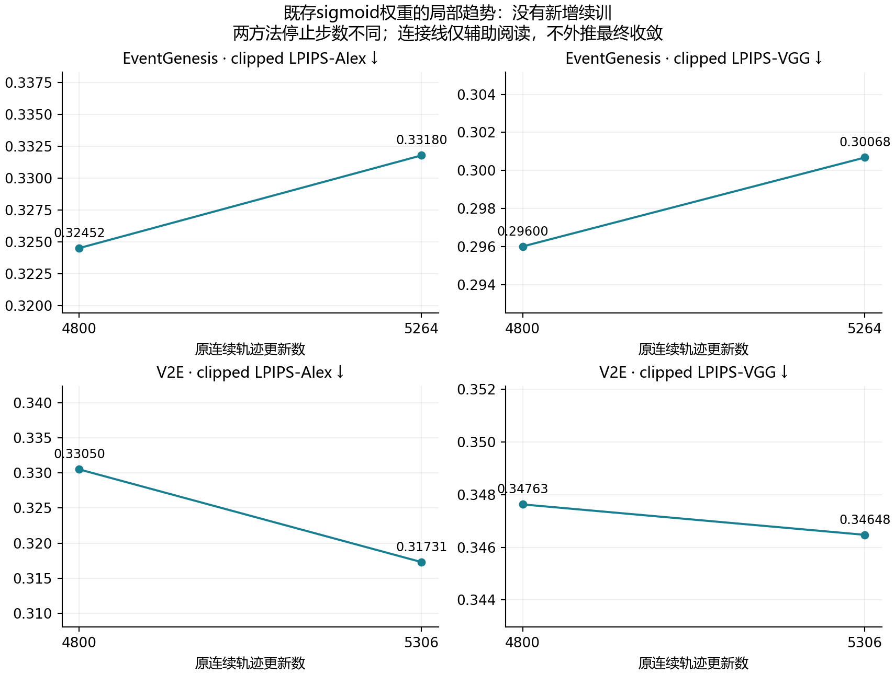
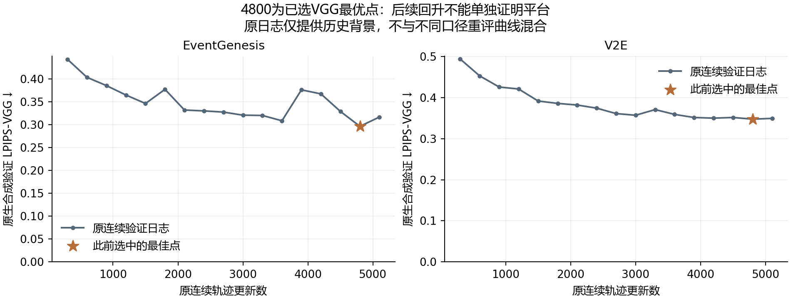

# 重建：训练进度与输出激活的合成短程配对诊断

输入证据时间：2026-11-07T18:06:45.330121+00:00。全部结果来自合成验证；本脚本只读结果、导出表格和图，不启动训练或真实测试。

主比较使用全部200帧；首5帧只预热的tail195同时完整导出。每项指标先在rollout内按帧平均，再对同一8条独立验证rollout等权平均；没有把帧当成独立重复。

配对检查：两方法各有线性/sigmoid两个seed0训练臂；四臂初始参数与实际标签/增强序列摘要一致，每种生成器内部事件序列摘要一致。跨生成器不要求事件相同。原损失、采样和预算保持共同配置，激活是短程对照中的实验变量。

## 600步同预算结果

| 事件来源 | 激活 | LPIPS-Alex ↓ | clipped LPIPS-VGG ↓ | SSIM ↑ | PSNR/dB ↑ | MSE ↓ | 对比度比 | 边缘幅值比 | 平坦帧比例 |
|---|---|---:|---:|---:|---:|---:|---:|---:|---:|
| EventGenesis | 线性输出 | 0.48167 | 0.44272 | 0.61733 | 16.51121 | 0.02265 | 0.20186 | 0.40953 | 0.00% |
| EventGenesis | sigmoid | 0.44774 | 0.40786 | 0.60368 | 15.56680 | 0.02786 | 0.20759 | 0.34908 | 0.00% |
| V2E | 线性输出 | 0.55702 | 0.49277 | 0.59218 | 16.24264 | 0.02421 | 0.17420 | 0.26855 | 0.00% |
| V2E | sigmoid | 0.52297 | 0.47033 | 0.59116 | 15.22170 | 0.03022 | 0.18288 | 0.27206 | 0.00% |

## 同步数的激活效应

差值统一为sigmoid减线性；LPIPS/MSE正值表示sigmoid误差更高，SSIM正值表示sigmoid更高。对比度与边缘比例只作机制诊断，不能一概认为越大越好。

| 事件来源 | 更新数 | ΔLPIPS-Alex | Δclipped VGG | ΔSSIM | Δ对比度比 | Δ边缘幅值比 |
|---|---:|---:|---:|---:|---:|---:|
| EventGenesis | 300 | -0.03896 | -0.04611 | +0.00863 | -0.01090 | -0.09056 |
| EventGenesis | 600 | -0.03394 | -0.03486 | -0.01365 | +0.00572 | -0.06045 |
| V2E | 300 | -0.05012 | -0.03730 | +0.00562 | +0.04711 | -0.00325 |
| V2E | 600 | -0.03405 | -0.02245 | -0.00102 | +0.00868 | +0.00350 |

## 300到600步的学习变化

差值为600步减300步，只描述本次有限训练区间。

| 事件来源 | 激活 | ΔLPIPS-Alex | Δclipped VGG | ΔSSIM | Δ对比度比 |
|---|---|---:|---:|---:|---:|
| EventGenesis | 线性输出 | -0.05855 | -0.04004 | +0.02711 | +0.01187 |
| EventGenesis | sigmoid | -0.05353 | -0.02879 | +0.00483 | +0.02849 |
| V2E | 线性输出 | -0.04156 | -0.02860 | +0.00533 | +0.01439 |
| V2E | sigmoid | -0.02550 | -0.01374 | -0.00130 | -0.02404 |

## 既存sigmoid连续轨迹的局部变化

以下没有新增续训：统一评估既存4800步与安全停止权重。两方法停止步数不同，只能各自在原轨迹内比较，不能作为相同增量的跨方法因果对照。

| 事件来源 | 原轨迹步数 | ΔLPIPS-Alex | Δclipped VGG | ΔSSIM | Δ对比度比 |
|---|---|---:|---:|---:|---:|
| EventGenesis | 4800→5264 | +0.00728 | +0.00468 | +0.00045 | -0.03319 |
| V2E | 4800→5306 | -0.01319 | -0.00116 | +0.01068 | +0.04603 |

## 数据支持的有限判断

- EventGenesis：600步时sigmoid的两项clipped感知误差均低于线性，本次短程结果不支持sigmoid必然降低画质。 相对被选中的4800步最佳点，后续有限区间未见两项感知误差改善；这受最佳点选择影响，不能据此判断平台。
- V2E：600步时sigmoid的两项clipped感知误差均低于线性，本次短程结果不支持sigmoid必然降低画质。 4800步后两项感知误差仍下降，说明该局部区间还在改善；这不是训练步数不足解释全部HQF差距的证明。

sigmoid原则上可以逼近[0,1]内的目标亮度；固定学习率、损失与激活的交互可能影响学习速度。平均导数≤0.25是sigmoid的基本性质，不单独构成饱和证据。近边界比例、对比度与边缘幅值只能与实际误差变化共同解释。

原linear历史最终权重只作为带真实步数的非等预算参考，见完整CSV；不能与sigmoid4800或600步直接相减来估计纯激活效应。raw LPIPS-VGG仅解释历史评价口径差异，主要质量比较始终使用clipped Alex/VGG。

**最佳点选择偏差：4800步是此前按合成VGG选出的最佳检查点，并非任意时间点。** 从已选的最小值出发，后续验证回升带有选择偏差；4800→停止点的局部变差不能当成平台或步数无效的证据。下面的原连续训练完整日志和按时间预定的末5点描述，为这一局部比较补充背景。

本轮只有seed0和8条合成验证轨迹，不提供p值或显著性声明。短程曲线不能证明永久容量上限，也不能单独证明HQF退步的全部成因；训练进度与激活/优化影响可以同时存在。不根据这些结果自动启动长训、选择真实检查点或调整真实后处理。

[所有时间点](all_timepoints.csv) · [逐rollout结果](per_rollout.csv) · [同预算激活差值](paired_activation_deltas.csv) · [学习变化](learning_changes.csv) · [机制指标](mechanisms.csv) · [配对检查](pairing_checks.json)

## 原连续训练的完整VGG日志与尾段背景

日志采用原生验证口径，与新评估器重评的指标分开列出，不静默拼成一条曲线。末段固定取最后5个按时间排序的验证点；斜率只是描述，不作显著性检验或未来收敛外推。

| 事件来源 | 完整日志点数 | 末段更新区间 | 末点−首点VGG | 描述性斜率/100步 |
|---|---:|---|---:|---:|
| EventGenesis | 17 | 3900→5100 | -0.05937 | -0.00632 |
| V2E | 17 | 3900→5100 | -0.00217 | -0.00023 |

[完整原生日志CSV](formal_validation_history.csv) · [按时间预定末段的描述CSV](formal_history_tail_trends.csv)

