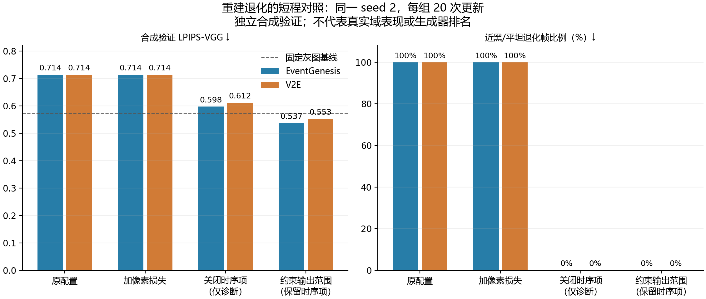

# 重建共同近黑退化：因果短训、修复与统一补跑

**最终核验快照：2026-11-07 22:20 JST。** 主配对300步检查66/66通过，额外三基线检查3/3通过；正式补跑已实际启动，尚未完成。

| 生成器 | seed | 合成 LPIPS-VGG ↓ | 预测/GT 对比度比 | 空间相关系数 | 退化帧比例 |
|---|---:|---:|---:|---:|---:|
| eventgenesis | 0 | 0.43905 | 0.1807 | 0.2568 | 0.0% |
| eventgenesis | 1 | 0.43314 | 0.1666 | 0.1614 | 0.0% |
| eventgenesis | 2 | 0.42739 | 0.2176 | 0.2270 | 0.0% |
| v2e | 0 | 0.48001 | 0.2226 | 0.2748 | 0.0% |
| v2e | 1 | 0.46577 | 0.1981 | 0.2748 | 0.0% |
| v2e | 2 | 0.47717 | 0.2021 | 0.1659 | 0.0% |

上述各组均为300次更新、8条完整独立合成验证序列；这张表用于检查共同训练修复，不作为生成器排名。

| 正式补跑 | 最新可核验更新 | update20→21恢复 |
|---|---:|---|
| eventgenesis_seed0 | 63/12,000 | pass |
| v2e_seed0 | 70/12,000 | pass |

[最终服务器证据](evidence/final_server_snapshot.json) · [300步完整结果CSV](diagnostic_tables/paired300_full_synthetic_validation.csv) · [补充基线CSV](diagnostic_tables/extra_baseline120_full_synthetic_validation.csv)

本轮只修复共同的重建下游训练配置。冻结事件仿真器核心 `62da4f35ce3c5c96f04268bd1687a27657af9238`、物理轨迹、合成事件、噪声、遮挡规则和标签均未改动；光流、位姿的现有作业未被修改或停止。

最新补跑状态与三 seed 采用检查见本目录的最终状态证据。以下 20 步消融已经完成，均为**合成数据结果，不是真实域排名**。旧 15 组训练、HQF 分数及 seed 2 失败仍保留在[上一轮完整结果](../three_line_followup_20261107/README.md)。

## 为什么五种生成器一起出问题

为了公平，同一个 seed 下五种生成器使用完全相同的模型初始参数和共同下游配置。因此它们并不是五次独立的初始化试验，共同训练陷阱会同时影响五组。

当前数据下，seed 2 的初始循环网络输出靠近零并偏负。原配置使用无范围约束的线性图像输出；时序项只比较相邻预测是否一致，对整段预测同时取反严格不变，而且其绝对值归一化分母在近零处会放大梯度。感知损失直接使用原始输出，不能保证输出是合法亮度；原合成选点与真实评分还分别使用 raw 和截到 [0,1] 的图像。负值进入真实评分时会被截成黑色。

这是**此处初始化与训练配方的稳定性问题**。原 E2VID+ 作者配置本来就使用线性输出，不能把它描述成误抄配置、原论文普遍有错，或五种 event generator 本体同时故障。训练过程中有有限损失和非零梯度，也不足以排除这种退化。

在一个固定合成训练窗口的探针中，EventGenesis seed 2 图像头偏置的 LPIPS 梯度为 -2.071，时序梯度为 +3.198，方向相反且后者更强；此处梯度下降会继续降低该偏置。其他 seed 的相对量级不同。该例不是所有参数与所有数据的唯一解释，但两组 TC 开关消融进一步确认了时序项参与退化，而非只靠梯度相关性推断。

## 已完成的因果对照

EventGenesis、V2E 的 seed 2；同一参数初始化、同一对 40 帧训练片段、同一裁剪与增强、每组 20 次真实 Adam 更新。八个臂的初始状态 SHA、实际标签/增强采样序列 SHA 全部相同；日志中的 1–20 次更新连续，梯度有限，恢复模型哈希和 Adam 计数均核对。

每组在 **8 条独立合成验证 rollout 的前 40 帧**评价，首 5 帧只预热，先在 rollout 内平均，再对 8 条 rollout 等权平均。没有真实数据参与。

| 配置 | EventGenesis LPIPS-VGG ↓ | V2E LPIPS-VGG ↓ | 两组近黑/平坦退化帧比例 |
|---|---:|---:|---:|
| 原线性输出 + 原损失 | 0.71403 | 0.71407 | 100% / 100% |
| 原配置 + 标准像素 L2（权重1） | 0.71402 | 0.71400 | 100% / 100% |
| 线性输出，仅关闭时序项（因果诊断） | 0.59782 | 0.61182 | 0% / 0% |
| 原生 sigmoid 输出，保留全部原损失 | 0.53706 | 0.55290 | 0% / 0% |

固定灰图 0.5 的 LPIPS 为 0.57143，全黑为 0.71396。关掉时序项能离开近黑解，但本次 20 步验证还不如固定灰图，因此没有采用“去掉时序损失”。加像素项在这 20 步中没有解决问题，不能推广成所有预算和权重均无效。

原生 sigmoid 既防止负亮度，又保留时序训练；两组输出与 GT 的空间相关系数分别为 0.286、0.267，LPIPS 已优于灰图。但其 20 步对比度仍偏低，所以**没有只凭这次固定窗口拟合就直接长训**。

[完整 CSV](diagnostic_tables/fixed20_synthetic_ablation.csv) · [初始化与梯度探针](diagnostic_tables/initialization_gradient_probes.csv) · [诊断图 PDF](diagnostic_tables/fixed20_synthetic_ablation.pdf) · [原始 20 步日志](diagnostic_tables)

## 修复选择和更严格的合成采用检查

修复只启用锁定实现已支持的 `final_activation="sigmoid"`。LPIPS-VGG 权重1、时序权重2、标签、事件表示、模型参数维度、Adam 与训练预算均不改变。[原始 E2VID 的作者实现](https://github.com/uzh-rpg/rpg_e2vid/blob/master/model/model.py)使用 sigmoid 图像输出；这是现成的图像范围约束，不是为 EventGenesis 单独增加网络或根据 HQF 分数寻找超参数。原 [E2VID+ 配置](https://github.com/TimoStoff/event_cnn_minimal/blob/master/config/reconstruction.json)作为线性对照保留。

随后对两方法、全部 seed 0/1/2 做相同预算的 **120 次不同训练窗口更新**，按原采样顺序覆盖正常训练窗口，并在全部 8 条独立合成验证 rollout、每条 200 帧上检查。使用原训练 loader、同一 24/8 整轨迹隔离，不以单窗口记忆替代泛化检查。

预登记的每个方法/seed 要求为：LPIPS 改善于自身初始化并优于固定黑图、灰图；MSE 优于黑图；预测/GT 标准差比 >0.1；空间相关系数 >0.1；首5帧后低标准差帧比例 <5%；图像范围合法；raw 与 clipped 的 LPIPS 一致；模型保存恢复哈希和 optimizer 计数正确。同 seed 的两方法还必须具有相同初始化及实际标签/增强序列。总计 66 项，全部通过才允许正式补跑，不删除 seed 或放宽阈值。

该轮实际为 **65/66 项通过**：仅 V2E seed1 的预测/GT 对比度比为 **0.095764**，低于原门槛 **0.1**。没有新的近黑退化、配对采样或初始化错误。全部失败项原样保留，v1 正式队列在取得 GPU、启动任何 optimizer 更新之前已被门槛拦住。

因此把两组全部三个 seed 统一检查到原配方首次完整验证时点：**前 5 epoch、300 次更新**。重新从同一注册参数初始化开始，EventGenesis 与 V2E 分别在 GPU0/1 并行，原模型、损失、数据、全部阈值均不改变。新完整采用记录明确关联两个实际 worker 的原始结果、检查点与释放收据，不把汇总目录冒充训练目录。最终采用要求仍是原 66 项全部通过。

另在 GPU1 对 Vid2E、FILM+ESIM、RIFE+ESIM 的 seed 2 做 120 步、全部独立序列检查，**三组均已通过**相同单模型质量要求。该补充检查的步数与后续主配对300步确认分别记录，不将不同短训预算拼成性能排名。

这些检查判断的是“共同下游模型能正常学习”，不判断生成器优劣。真实 HQF 没有参与修复候选或门槛选择；它此前已经看过，之后的重复测试必须明确作为既见数据上的开发结果，不能再称盲测。

## 保存、恢复与推理接口已提前核验

除短训模型/Adam 恢复外，还在 g1 CPU 上实际调用了**本轮正式 trainer 的原始 `save_checkpoint` 函数**，再由现有推理适配器的 `checkpoint_to_model` 函数加载，检查两组 seed 2 的输出激活配置、权重与数值结果。三个连续数值探针的最大输出误差均为 0，范围仍在 [0,1]；误传旧线性输出配置时会拒绝加载。

这只是序列化与接口预检，不是新的训练或真实精度结果。临时程序检查点不作为训练权重保留；原始 20 步模型仍在独立诊断目录，来源 SHA 和 CPU 检查收据均在证据中。

被提取的推理函数在**实际训练解释器 Python3.11**中核对，与 g1 原部署函数 AST 一致。早先系统 Python 的跨版本 AST 哈希比较不具可比性，不能据其散列不同认定代码不同；同运行时复核已消除此歧义。第三方及原部署文件均未修改。

代码保持性检查还核对了数据类、RNG 保存恢复、样本摘要、sampler、循环状态预检、optimizer 调用的 AST，以及除声明元数据外的 checkpoint/cursor 逻辑。13 项检查通过；另有 14 项采用门槛反例、8 项启动边界反例程序检查。它们不替代实际 GPU 短训与 update20→21 的跨进程恢复。

## 统一正式补跑的规则

新运行根目录：`/home/zhaoyuhan/Eventbased_WAM/runs/sim2real/20261107-recon-sigmoid-formal-v2`。`formal-v1` 的无训练拦截证据保留。

- 五种生成器 × 三 seed，15 组都从原注册种子的同一参数初始化重新训练；不只替换 seed 2，不沿用旧线性模型的 seed0/1 分数拼表。
- 预算仍为 200 epoch、12,000 次 optimizer 更新、有效 batch 两个 40 帧片段。参数初始 SHA 与原 CPU 参考完全一致；sigmoid 不增加参数。
- 每组先在真实独立进程中完成 update20→21 恢复，校验样本/增强、损失和 Adam 计数，再继续同一预算；配置、源码和数据 SHA 不一致会拒绝启动或恢复。
- 正式 checkpoint 明确保存 `model_args` 与修复配方；每 5 epoch 对完整合成验证进行输出范围、对比度和退化比例检查，失败即保留检查点并停止新队列任务，防止跑满后才发现共同退化。
- 新增 GPU0/1 作业和 GPU2 后续工作均使用原子预约与实际进程检查。GPU2 工作者只在现有光流任务自然完成并释放后加入，绝不终止或改动其训练。等待数据或门槛时不占 GPU，作业结束自动释放。
- 旧的共享 Git 工作树、所有原结果、光流和位姿作业保持原样；新运行源码快照独立。真实评分在本轮正式训练与 checkpoint 冻结前保持关闭。

[正式运行源码](formal_sources) · [相对原 trainer 的差异](verification/trainer_delta.patch) · [不可变源文件 SHA](formal_sources/source_manifest.json) · [因果实验与保存检查证据](evidence/diagnostic_evidence.json)

35项程序检查可在仓库内直接重跑：`python benchmark/sim2real/reviews/reconstruction_repair_20261107/verification/run_preflights.py`。只用标准库，不占GPU、不启动训练。未来真实评分的配置边界见[评分交接说明](EVALUATION_HANDOFF.md)。

本轮结果不构成 EventGenesis 相对其他生成器的真实域优势声明。下一次结果表必须来自统一修复配方的完整同预算训练和同一真实评价协议。

### 光流任务只读补充快照

本次未改动光流或位姿任务。光流日志字段与重建不同，通用采集器未取出的更新由[专用只读采集证据](evidence/flow_supplement.json)补充；原始快照保持不变。
